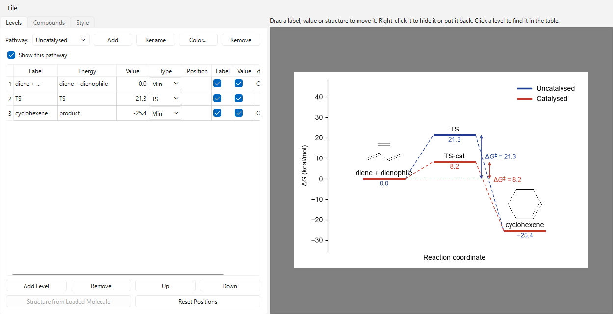

# Reaction Energy Diagram Plugin

[](https://github.com/HiroYokoyama/moleditpy_energy_diagram/actions/workflows/ci.yml)
[](https://github.com/HiroYokoyama/moleditpy_energy_diagram/tags)
[](https://github.com/HiroYokoyama/moleditpy_energy_diagram/releases)



## Overview

A separate MoleditPy window for drawing reaction energy profiles at publication
quality. Collect the energies of the compounds as you open their calculations one after
another, write each level as a sum of compounds, and export the figure as SVG, PDF, EPS,
PNG or TIFF.

The diagram is kept apart from the molecule: opening another file or **File > New** in
MoleditPy never clears it, so values can be gathered across many output files.

## Features

- **Compounds**: energies in Hartree, read from ORCA, Gaussian and GAMESS output files
  (electronic energy *E*, enthalpy *H* or Gibbs free energy *G*; the last value in the
  file is used). **From Open Document** reads the output file MoleditPy has open. Reading
  a file again updates the compound with the same name. Energies can also be typed.
- **From Result Analyzer**: when the ORCA, Gaussian or GAMESS Result Analyzer plugin is
  installed, pick any value it has read from the open output file: final SCF energy,
  E + ZPE, U, H, G, or the ZPE, enthalpy and Gibbs corrections (for example a
  high-level single point plus a low-level `Gcorr`). Without an analyzer the button
  does not appear.
- **Levels**: each level's energy is a number in the input unit or an expression of
  compounds, for example `cat + sub`, `TS1 - cat`, `2*monomer` or `{Pd(PPh3)2} + L`.
  Values are shown relative to the first level of the first visible pathway, in
  kcal/mol, kJ/mol, eV or Hartree.
- **Pathways**: several pathways in their own colours, each shown or hidden. A new
  pathway copies the steps of the current one, ready for the other energies. Levels are
  minima or transition states, placed in order or at a chosen position so pathways can
  share or skip steps.
- **Mouse placement**: drag any label, value, structure or barrier value to move it.
  Right-click it to hide it, edit it or put it back; right-click a level for its
  colour and visibility. Click a level to find it in the table.
- **Style**: everything on the figure can be set.
  - Text: a main font, and for level labels, values, barrier values, axis titles, axis
    numbers, the figure title and the legend each its own font, size, bold, italic and
    colour (values and labels can follow their pathway's colour).
  - The quantity symbol is written as IUPAC does by default: Δ*G*, with the letter
    italic and Δ upright, and Δ*G*‡ on barriers. Labels and titles accept matplotlib
    math text, e.g. `TS$_1$` or `$\mathbf{1}$`.
  - Energies: decimals, sign, parentheses and unit on values.
  - Levels and connectors: dashed, dotted, solid, smooth-curve or no connectors, their
    colour and thickness, bar width and thickness, the gap to labels and values.
  - Barriers (Δ*G*‡) from the minimum before each transition state: arrow heads,
    thickness, the dotted guide, and whether the symbol is written.
  - 2D structures drawn from SMILES (**Structure from Loaded Molecule** takes the
    molecule in MoleditPy) and their size.
  - Axes: energy axis and bottom line, line thickness and colour, tick direction, a
    fixed range and tick interval, side margins.
  - Legend position and frame; figure size, background colour or transparency.
    **Reset Style to Defaults** puts it all back.
- The figure on screen has the exported size, so what is placed is what is exported.
  SVG keeps text as text for later editing; PDF and EPS embed the fonts.
- **Files**: diagrams are saved as `.pmeedg` files, which MoleditPy opens directly.
  With **File > Store in the MoleditPy Project File** ticked, the diagram is also saved
  inside the `.pmeprj` project and comes back when the project is opened. The current
  diagram is kept between sessions even when it was never saved.

## Usage

1. Open **Extensions > Reaction Energy Diagram...**.
2. On the **Compounds** tab, choose *G*, *H* or *E* and add the output files with
   **From Output Files...**, or use **From Open Document** while you go through the
   calculations in MoleditPy.
3. On the **Levels** tab, add a level per step and write its energy, for example
   `cat + sub` for the starting point and `TS1` for the transition state.
4. Set the look on the **Style** tab, drag labels into place, and use
   **File > Export Image...** or **Copy Image**.
5. **File > Save** writes a `.pmeedg` file.

The window also runs on its own: `python -m energy_diagram [file.pmeedg]`.

## Requirements

matplotlib, besides what MoleditPy already provides (PySide6; RDKit for structures).

## Development and testing

```bash
python -m pytest tests/ -v
ruff format energy_diagram tests && ruff check energy_diagram tests
```

The energy model, expression parser and layout in `energy_diagram/model.py` have no Qt or
matplotlib dependency. The output parsers are checked against real ORCA, Gaussian and
GAMESS outputs when the sibling result-analyzer repositories are checked out. The window
is tested with a real Qt and a fake host context, including dragging with mouse events,
and `tests/test_api.py` checks every host API call against the MoleditPy source when it
is checked out beside this repository.

## Licensing scope

First-party code is LGPL-3.0-or-later. See [LICENSE](LICENSE), [COPYING](COPYING) and
[dependency/provenance terms](LICENSING.md). Third-party components retain their own
terms.
